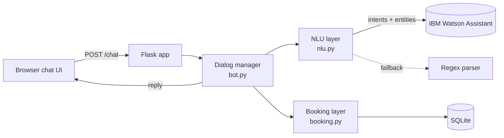

<div align="center">

# 🏢 Watson Room Booking Bot

**Book a meeting room by simply asking for one.**
A conversational assistant powered by IBM Watson Assistant, Flask and SQLite.


</div>

---

## ✨ What it does

Type *"Book a room for 5 people tomorrow at 2pm for 2 hours"* and the bot understands it, asks only for what is missing, checks for clashes, and confirms your booking.

| | Feature |
|---|---|
| 🗣️ | **Natural-language booking** with IBM Watson intents and entities |
| 🧩 | **Guided slot filling**: asks for date, time, duration, attendees and name only when needed |
| 🛡️ | **Double-booking protection**: overlap check, re-verified at write time |
| ✅ | **Business-rule validation**: opening hours, capacity, past dates, duration limits |
| 🔎 | **Availability search**, **list** and **cancel** bookings from chat |
| 🔌 | **Offline demo mode**: regex fallback runs the bot with no cloud account |
| 🌗 | **Responsive chat UI** with light and dark themes and keyboard focus styles |

## 🎬 Example

```text
You : Book a room for 5 people tomorrow at 2pm
Bot : For how many hours?
You : 2
Bot : What name should I book it under?
You : Asha
Bot : Bhaskara (meeting, seats 8) is free on 2026-11-13 14:00-16:00 for 5 people.
      Shall I confirm the booking for Asha? (yes/no)
You : yes
Bot : Booked! Booking #1 ... Say 'cancel 1' to cancel.
```

## 🧠 How it works



**Design principle:** Watson decides *what the user means*; application code decides *what to do*. Business rules stay testable and independent of the cloud service, and the bot degrades gracefully if Watson is unreachable.

## 🧰 Tech stack

Python · Flask · IBM Watson Assistant (v2 API) · SQLite · HTML/CSS/JavaScript · pytest

## 🚀 Quick start

```bash
git clone https://github.com/yogitha-singh/watson-room-booking-bot.git
cd watson-room-booking-bot
python -m venv venv
venv\Scripts\activate            # Mac/Linux: source venv/bin/activate
pip install -r requirements.txt
python app.py
```

Open **http://localhost:5000**. With no credentials it runs in demo mode; check `/health` to see whether NLU is `watson` or `fallback`.

### Enable IBM Watson (optional)

1. Create a free **Watson Assistant** instance on IBM Cloud and an assistant.
2. **Add a dialog skill → Upload** `watson/skill-dialog.json`.
3. Enable system entities `@sys-date`, `@sys-time`, `@sys-number`.
4. Copy `.env.example` to `.env` and fill in `WATSON_API_KEY`, `WATSON_URL`, `WATSON_ASSISTANT_ID`.
5. Restart the app. `/health` should now report `"nlu": "watson"`.

## 🎯 Watson design

| Intent | Example |
|---|---|
| `book_room` | "reserve a conference room" |
| `check_availability` | "which rooms are free at 11am" |
| `cancel_booking` | "cancel booking 12" |
| `list_bookings` | "show my bookings" |
| `greeting`, `goodbye` | "hello", "thank you" |

Entities: `@sys-date`, `@sys-time`, `@sys-number`, and a custom `@room_type` (meeting, conference, seminar, huddle) with synonyms.

## 📏 Business rules

- Bookings between **08:00 and 20:00**, lasting **0.5 to 8 hours**
- **1 to 30** attendees, no dates in the past
- No overlapping bookings in the same room
- The **smallest suitable room** is offered first

| Room | Seats | Type |
|---|---|---|
| Eka | 2 | Huddle |
| Aryabhata | 4 | Meeting |
| Bhaskara | 8 | Meeting |
| Charaka | 12 | Conference |
| Dhruva | 30 | Seminar |

## 🗂️ Project structure

```text
watson-room-booking-bot/
├── app.py                  # Flask routes: /, /chat, /health
├── bot.py                  # Dialog manager, slot filling, validation
├── nlu.py                  # Watson integration + regex fallback
├── booking.py              # SQLite data layer, overlap-safe booking
├── static/index.html       # Chat UI
├── watson/skill-dialog.json# Importable Watson skill
├── tests/test_bot.py       # Conversation tests
├── docs/bot-demo.png        # Screenshot
├── requirements.txt
└── .env.example
```

## 🧪 Testing

```bash
pytest -q tests
```

| Test | Verifies |
|---|---|
| `test_full_booking_flow` | Slot filling and confirmation create a booking |
| `test_conflict_hides_booked_room` | Booked rooms are not offered for overlapping times |
| `test_validation_opening_hours` | A 06:00 start is rejected |
| `test_list_and_cancel` | Bookings can be listed by name and cancelled |

## ⚠️ Limitations

Dialog state is held in memory (resets on restart), bookings are matched by name with no authentication, times use the server's time zone, and the bot is English-only with a small Watson training set.

## 🔭 Roadmap

- [ ] SSO authentication
- [ ] Google and Outlook calendar sync
- [ ] Email confirmations
- [ ] Redis session store and PostgreSQL
- [ ] Use `@room_type` preference in room search
- [ ] Multilingual support and voice input (Watson Speech to Text)
- [ ] Deploy to IBM Cloud Code Engine

## 👩‍💻 Author

**Yogitha Singh** · [GitHub @yogitha-singh](https://github.com/yogitha-singh)

---

<div align="center">If you found this useful, consider giving it a ⭐</div>
